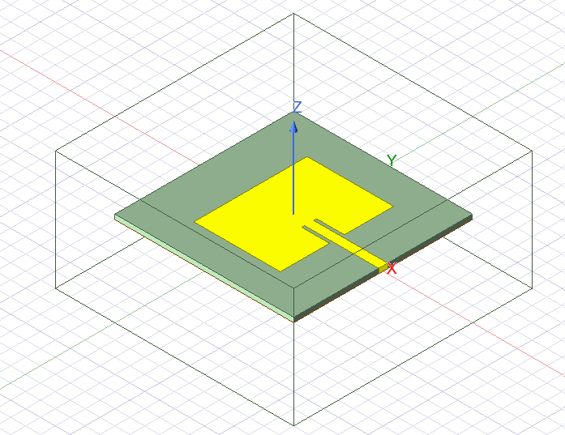
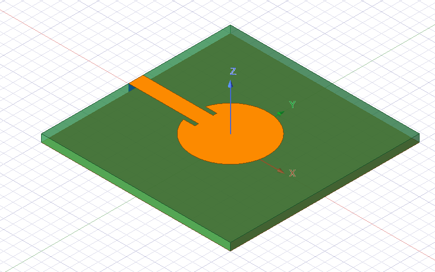
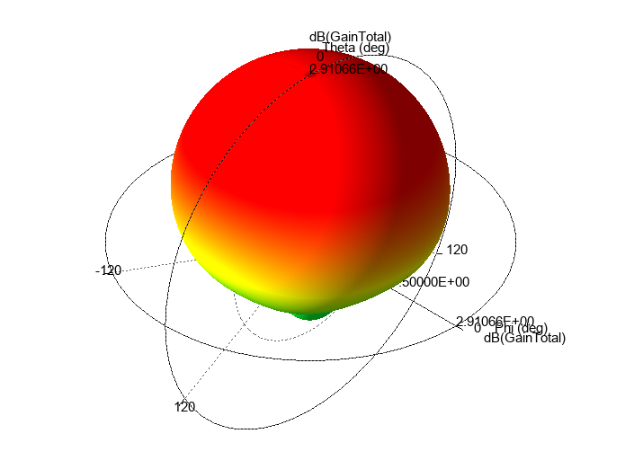
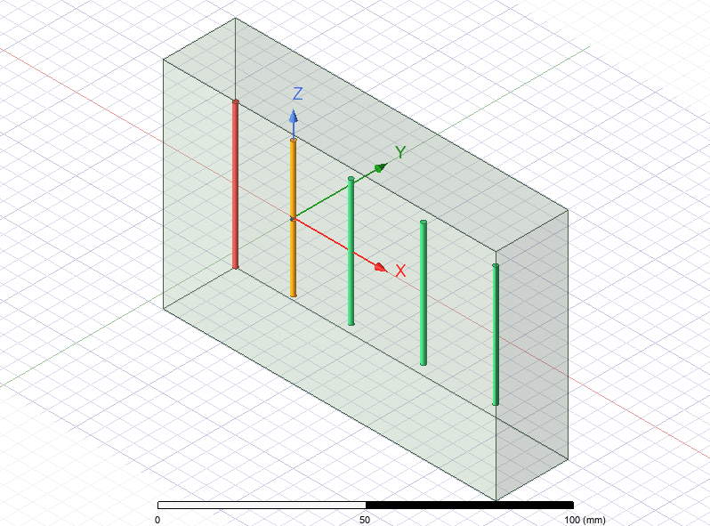
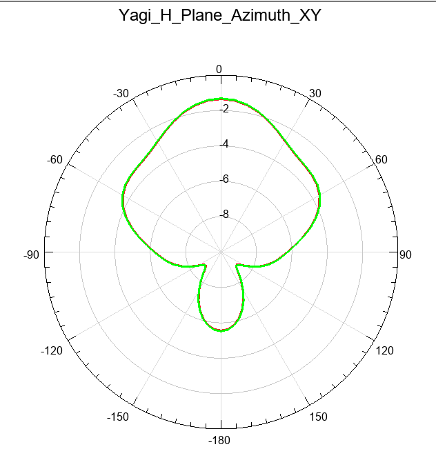
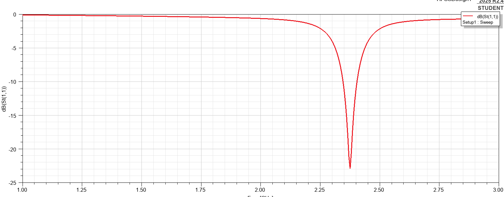

<p align="center">
  
  
  
  
</p>

<h1 align="center">📡 Antenna Design & Wave Propagation Lab</h1>

<p align="center">
  <i>A collection of HFSS simulation files and Python automation scripts for various antenna designs, developed as part of the <b>Antenna Design and Wave Propagation Lab</b> academic course.</i>
</p>

<p align="center">
  <a href="https://github.com/ExTc-aShiSh/Antenna_Design_HFSS">
    
  </a>
  <a href="https://github.com/ExTc-aShiSh/Antenna_Design_HFSS/fork">
    
  </a>
</p>

---

## 📖 About

This repository documents my academic journey in learning **antenna design and wave propagation** using **Ansys HFSS** (High-Frequency Structure Simulator). It contains ready-to-use HFSS simulation project files (`.aedt`) and companion **Python automation scripts** that can programmatically build, configure, and simulate these antenna models via **PyAEDT**.

Whether you're a fellow student, educator, or RF enthusiast — feel free to explore, learn, and build upon these designs.

---

## 🖼️ Simulation Gallery

<table align="center">
  <tr>
    <td align="center"><br/><sub>2.4 GHz Patch Antenna</sub></td>
    <td align="center"><br/><sub>Circular Patch Antenna</sub></td>
    <td align="center"><br/><sub>Patch Radiation Pattern</sub></td>
  </tr>
  <tr>
    <td align="center"><br/><sub>Yagi-Uda Model</sub></td>
    <td align="center"><br/><sub>Yagi-Uda H-Plane Pattern</sub></td>
    <td align="center"><br/><sub>Patch Antenna S11 Return Loss</sub></td>
  </tr>
</table>

---

## 🏗️ Repository Structure

```
Antenna_Design_HFSS/
│
├── HFSS_Simulation_Files/            # Ansys HFSS project files (.aedt)
│   ├── 2.4Ghz Patch Antenna.aedt
│   ├── Broadside_arrray_3Ghz.aedt
│   ├── Circular_Patch_Antenna_5Ghz.aedt
│   ├── Dipole_antenna_2p4Ghz.aedt
│   ├── Endfire Array 2p4GHz.aedt
│   ├── Variable_length_Dipole.aedt
│   ├── Yagi_Uda_2p4Ghz.aedt
│   └── yagi_uda_3Ghz.aedt
│
├── Python_scripts_for_Antenna/       # PyAEDT automation scripts
│   ├── hfss_broadside_array_3ghz.py
│   ├── hfss_circular_patch_5ghz.py
│   ├── hfss_yagi_uda_2p4ghz.py
│   └── hfss_yagi_uda_3ghz.py
│
├── images/                           # Simulation screenshots & results
│   ├── 2.4GHzpatch_antenna.png
│   ├── Circular_patch_antenna.png
│   ├── Patch_Antenna_s11.png
│   ├── Patch_radiation.png
│   ├── yagi_Hplane.png
│   └── yagi_model.png
│
├── ashish_antenna.pdf                # Lab report / documentation
├── LICENSE
└── README.md
```

---

## 📡 Antenna Designs Included

| # | Antenna Design | Frequency | Simulation File | Script |
|---|---------------|-----------|----------------|--------|
| 1 | **Rectangular Patch Antenna** | 2.4 GHz | `2.4Ghz Patch Antenna.aedt` | — |
| 2 | **Circular Patch Antenna** | 5 GHz | `Circular_Patch_Antenna_5Ghz.aedt` | ✅ `hfss_circular_patch_5ghz.py` |
| 3 | **Half-Wave Dipole Antenna** | 2.4 GHz | `Dipole_antenna_2p4Ghz.aedt` | — |
| 4 | **Variable-Length Dipole** | Variable | `Variable_length_Dipole.aedt` | — |
| 5 | **5-Element Yagi-Uda Antenna** | 2.4 GHz | `Yagi_Uda_2p4Ghz.aedt` | ✅ `hfss_yagi_uda_2p4ghz.py` |
| 6 | **Yagi-Uda Antenna** | 3 GHz | `yagi_uda_3Ghz.aedt` | ✅ `hfss_yagi_uda_3ghz.py` |
| 7 | **4-Element Broadside Array** | 3 GHz | `Broadside_arrray_3Ghz.aedt` | ✅ `hfss_broadside_array_3ghz.py` |
| 8 | **Endfire Antenna Array** | 2.4 GHz | `Endfire Array 2p4GHz.aedt` | — |

---

## 🛠️ Tech Stack

<p align="center">
  
  
  
  
  
  
  
</p>

---

## ⚠️ Maintenance Notice

> [!IMPORTANT]
> **This repository will not be actively maintained after November 22, 2026.**
> It was created as part of an academic lab course and has served its purpose. That said, **I am open to accepting new Pull Requests** — if you'd like to add new designs, fix issues, or improve existing scripts, feel free to submit a PR and I'll review it when I can.

---

## 🤝 Contributing

Contributions are welcome and greatly appreciated! Whether it's a new antenna design, a bug fix, documentation improvement, or a new automation script — every contribution counts. Feel free to fork the repo and open a Pull Request.

---

## 📜 License

This project is licensed under the **MIT License** — see the [LICENSE](LICENSE) file for details.

You are free to use, modify, and distribute these designs and scripts for educational and personal purposes.

---

<p align="center">
  Made with ❤️ by <a href="https://github.com/ExTc-aShiSh">Ashish</a>
</p>

